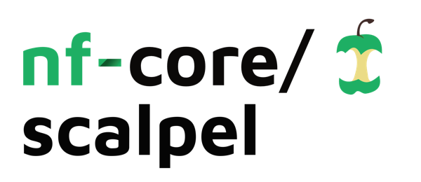
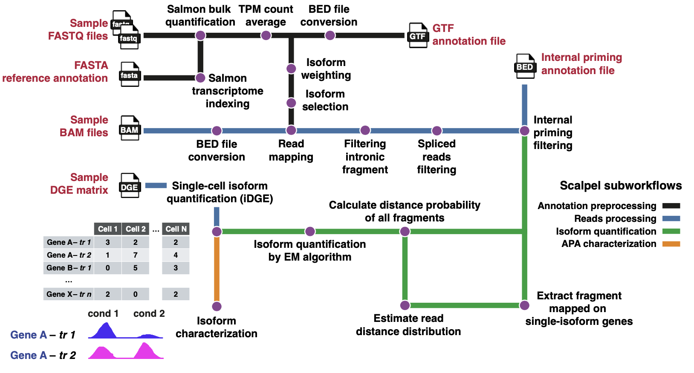

<h1>
  <picture>
    <source media="(prefers-color-scheme: dark)" srcset="docs/images/nf-core-scalpel_logo_dark.png">
    
  </picture>
</h1>

[](https://nf-core-scalpel.readthedocs.io/en/latest/)
[](https://www.nf-test.com)
[](https://www.nextflow.io/)
[](https://github.com/nf-core/tools/releases/tag/3.4.1)
[](https://docs.conda.io/en/latest/)
[](https://www.docker.com/)
[](https://sylabs.io/docs/)
[](https://cloud.seqera.io/launch?pipeline=https://github.com/plasslab/nf-core-scalpel)

[](https://nfcore.slack.com/channels/scalpel)
[](https://bsky.app/profile/nf-co.re)
[](https://mstdn.science/@nf_core)
[](https://www.youtube.com/c/nf-core)

## Introduction

**nf-core/scalpel** quantifies transcript isoforms and alternative polyadenylation (APA) at the single-cell level from 3'-tagged scRNA-seq data (10x Genomics Chromium 3', Drop-seq), as described in [Ake et al., _Nat Commun_ 2025](https://doi.org/10.1038/s41467-025-61118-0).

1. **Annotation processing** — salmon pseudobulk quantification and selection of the isoforms distinguishable by 3'-tagged reads (isoforms with close 3' ends and identical exons near the 3' end are collapsed).
2. **Reads processing** — reads of the filtered cells mapped to the selected isoforms, internal priming artifacts removed.
3. **Isoform quantification** — EM estimation of the isoform abundances per cell and gene, isoform-by-cell count matrices (iDGE).
4. **APA characterization** — differential isoform usage between samples or cell clusters.

<div align="center">
  
</div>

Full documentation, tutorials and the scalpelR reference: **[nf-core-scalpel.readthedocs.io](https://nf-core-scalpel.readthedocs.io/en/latest/)**.

## Usage

> [!NOTE]
> If you are new to Nextflow and nf-core, please refer to [this page](https://nf-co.re/docs/usage/installation) on how to set-up Nextflow (>= 26.04). Test your setup with `-profile test` before running the workflow on actual data.

### Quick test

```bash
nextflow run plasslab/nf-core-scalpel -profile test,docker --outdir results_test
```

Use `conda`, `singularity` or `apptainer` instead of `docker`, `test_dropseq` for the Drop-seq test data, and add `emulate_amd64` on Apple Silicon with Docker.

### Samplesheet

```csv title="samplesheet.csv"
sample,fastq_1,fastq_2,cranger_path
SRR6129050,fastq/SRR6129050_R1.fastq.gz,fastq/SRR6129050_R2.fastq.gz,cellranger/SRR6129050
SRR6129051,fastq/SRR6129051_R1.fastq.gz,fastq/SRR6129051_R2.fastq.gz,cellranger/SRR6129051
```

| Column         | Description                                                                                      |
| -------------- | ------------------------------------------------------------------------------------------------ |
| `sample`       | Sample name (no spaces). Several rows with the same name = several runs of one sample.            |
| `fastq_1/2`    | R1 / R2 FASTQ files (optional with `--isoform_annotation`).                                       |
| `cranger_path` | Cell Ranger, Cell Ranger ARC or STARsolo sample directory (Drop-seq: BAM file).                  |
| `dge`          | Drop-seq only: Drop-seq tools DGE count matrix.                                                  |

### Running the pipeline

```bash
nextflow run plasslab/nf-core-scalpel \
   -profile <docker/singularity/conda/.../institute> \
   --samplesheet samplesheet.csv \
   --transcriptome gencode.vM21.transcripts.fa.gz \
   --gtf gencode.vM21.annotation.gtf.gz \
   --genome GRCm38.primary_assembly.genome.fa.gz \
   --outdir results
```

The internal priming reference is built from `--genome`; a pre-built one can be given with `--ip_reference` ([mm10](https://zenodo.org/records/15664563/files/mm10_polya.track.tar.gz?download=1), [GRCh38](https://zenodo.org/records/15717592/files/hg38_ipriming_sites.bed.tar.gz?download=1), or `<outdir>/ip_reference/` of a previous run). BAM files, GTF and genome must use the same chromosome names (checked by the pipeline).

| Option                    | Use                                                                                 |
| ------------------------- | ----------------------------------------------------------------------------------- |
| `--clusters`              | Compare cell clusters instead of samples (`sample`, `barcode`, `cluster`).           |
| `--barcodes_whitelist`    | Restrict the analysis to selected cells (CSV `sample,barcodes`).                     |
| `--isoform_annotation`    | Reuse the isoforms of a previous run (`<outdir>/isoform`) to add samples; BAM input only. |
| `--sequencing_platform`   | `chromium` (default) or `dropseq`.                                                   |

### Parameters

| Parameter            | Default | Description                                                                 |
| -------------------- | ------- | --------------------------------------------------------------------------- |
| `--distance_3end`    | `100`   | Maximum distance (nt) between the 3' ends of collapsed isoforms.             |
| `--distance_profile` | `500`   | Window (nt from the 3' end) where collapsed isoforms have identical exons.   |
| `--distance_reads`   | `600`   | Maximum distance (nt) of a read from the isoform 3' end.                     |
| `--min_mapq`         | `255`   | Minimum mapping quality (255: uniquely mapped reads).                        |
| `--distance_ip`      | `200`   | Internal priming sites closer to the 3' end are ignored.                     |
| `--gene_fraction`    | `98%`   | Genes used to learn the read distance distribution.                          |
| `--binsize`          | `20`    | Bin size (nt) of the read distance distribution.                             |
| `--em_tol`           | `1e-6`  | EM convergence tolerance.                                                    |
| `--em_max_iter`      | `1000`  | Maximum number of EM iterations.                                             |
| `--diu_test`         | `chisq` | Differential isoform usage test: `chisq` or `permutation` (cells permuted).  |
| `--diu_min_delta`    | `0.1`   | Minimal isoform usage change for a significant gene.                         |

See the [usage documentation](https://nf-core-scalpel.readthedocs.io/en/latest/usage.html) for details.

> [!WARNING]
> Please provide pipeline parameters via the CLI or Nextflow `-params-file` option. Custom config files including those provided by the `-c` Nextflow option can be used to provide any configuration _**except for parameters**_; see [docs](https://nf-co.re/docs/usage/getting_started/configuration#custom-configuration-files).

## Pipeline output

| Directory        | Content                                                                                 |
| ---------------- | --------------------------------------------------------------------------------------- |
| `dge/`           | Isoform count matrices per sample (sparse 10x format, features `gene***isoform`).        |
| `differential/`  | Differential isoform usage (`DIU_table.csv`) and Seurat object (`iDGE_seurat.RDS`).      |
| `filtered_bams/` | Reads used for the quantification.                                                      |
| `isoform/`       | Selected isoforms (reusable with `--isoform_annotation`).                               |
| `ip_reference/`  | Internal priming reference built from the genome.                                        |
| `probability/`   | Read distance distribution to the 3' end per sample.                                     |
| `pipeline_info/` | Execution reports and software versions.                                                 |

Intermediate files (`salmon/`, `transcript/`, `bed/`, `reads/`, `ip/`, `fragment/`, `cell/`, `em/`) are described in the [output documentation](https://nf-core-scalpel.readthedocs.io/en/latest/output.html).

### Downstream analysis

- [10X Chromium example](https://nf-core-scalpel.readthedocs.io/en/latest/tutorials/chromium.html) · [downstream analysis](https://nf-core-scalpel.readthedocs.io/en/latest/tutorials/chromium_downstream.html)
- [Drop-seq example](https://nf-core-scalpel.readthedocs.io/en/latest/tutorials/dropseq.html) · [downstream analysis](https://nf-core-scalpel.readthedocs.io/en/latest/tutorials/dropseq_downstream.html)

### Testing

`quarto render test.qmd` runs the test suite (end-to-end runs, regression and unit tests) and writes a report.

## Credits

nf-core/scalpel was originally written by Franz AKE.

We thank the following people for their extensive assistance in the development of this pipeline:

- Marcel Schilling
- Sandra M. Fernández-Moya
- Akshay Jaya Ganesh
- Ana Gutiérrez-Franco
- Lei Li
- Mireya Plass

## Contributions and Support

If you would like to contribute to this pipeline, please see the [contributing guidelines](.github/CONTRIBUTING.md).

For further information or help, don't hesitate to get in touch on the [Slack `#scalpel` channel](https://nfcore.slack.com/channels/scalpel) (you can join with [this invite](https://nf-co.re/join/slack)).

## Citations

If you use nf-core/scalpel for your analysis, please cite:

> Franz Ake, Marcel Schilling, Sandra M. Fernández-Moya, Akshay Jaya Ganesh, Ana Gutiérrez-Franco, Lei Li, Mireya Plass.
> **Quantification of transcript isoforms at the single-cell level using SCALPEL.**
> _Nat Commun_ 16, 6402 (2025). doi: [10.1038/s41467-025-61118-0](https://doi.org/10.1038/s41467-025-61118-0)

An extensive list of references for the tools used by the pipeline can be found in the [`CITATIONS.md`](CITATIONS.md) file.
