# Downstream analysis on scRNA-seq from mouse spermatogenesis using SCALPEL


``` r
suppressPackageStartupMessages(library(Seurat, quietly = TRUE))
suppressPackageStartupMessages(library(dplyr, quietly = TRUE))
suppressPackageStartupMessages(library(data.table, quietly = TRUE))
suppressPackageStartupMessages(library(ggplot2, quietly = TRUE))
suppressPackageStartupMessages(library(scalpelR, quietly = TRUE))
```

The functions used in this downstream analysis are provided by the R package scalpelR, installed from its [Github page](https://github.com/Franzx7/scalpelR):

``` r
install.packages("remotes")
remotes::install_github("Franzx7/scalpelR@dev")
#- optional, pseudotime of the cells (heatmap along the differentiation)
BiocManager::install("slingshot")
library(scalpelR)
```

| Function | Use |
|----|----|
| `FindIsoforms` | Differential isoform usage between groups of cells (same method as the pipeline DIU table). |
| `plotUsage` | Isoform usage (fraction of the gene) per group and sample. |
| `CoveragePlot` | Read coverage of a gene per group of cells, from the SCALPEL filtered BAM files. |
| `weightedUTR_cell` | Weighted 3’ UTR length per cell. |
| `plotShiftHeatmap` | Heatmap of the 3’ UTR shifts of the genes between groups of cells or along a trajectory. |
| `subsetBAM` | BAM file of the reads of selected cells (e.g. genome browser). |

## Introduction

In this example, we perform a gene and isoform level single-cell analysis of the 10X 3’ Chromium scRNA-seq dataset of adult mouse spermatogenesis ([GSE104556](https://www.ncbi.nlm.nih.gov/geo/query/acc.cgi?acc=GSE104556), samples SRR6129050 and SRR6129051, two mice), processed with Cell Ranger (mm10-2020-A reference) and SCALPEL with the default parameters, on the full dataset:

``` sh
nextflow run plasslab/nf-core-scalpel -r dev -profile singularity \
    --samplesheet samplesheet.csv \
    --transcriptome gencode.vM23.transcripts.fa.gz \
    --gtf gencode.vM23.annotation.gtf.gz \
    --genome GRCm38.primary_assembly.genome.fa.gz \
    --outdir results
```

The files used by this downstream analysis are:

``` sh
> tree results/differential results/filtered_bams results/isoform -L 1
results/differential
├── DIU_table.csv
├── DIU_warnings.txt
├── iDGE_seurat.RDS
└── samples_qc.tsv
results/filtered_bams
├── SRR6129050_filtered.bam
├── SRR6129050_filtered.bam.bai
├── SRR6129051_filtered.bam
└── SRR6129051_filtered.bam.bai
results/isoform
├── chr1.annots.gz
...
```

## Gene-level analysis: cell types

We first annotate the cells with a standard gene-level analysis of the Cell Ranger count matrices.

> [!IMPORTANT]
>
> **Cell quality control.** Cell Ranger (\>= 7) calls ~11,700 barcodes on these samples, but the number of genes per barcode is bimodal: ~2,400 cells with ~5,000 genes, and ~9,000 barcodes with ~1,000 genes (droplets with little RNA, mostly ambient transcripts). These low-RNA barcodes form a mixed cloud in the UMAPs and blur the isoform-level analysis even more than the gene-level one, as their few UMIs are split between the isoforms of each gene. We keep the cells with \>= 3000 genes (valley of the distribution) and \< 10% mitochondrial reads.

The cell types are then annotated with marker genes of the spermatogenesis stages (spermatocytes, round spermatids, elongating spermatids) and of the somatic cells.

``` r
#- Cell Ranger gene counts of the two samples...
dge.obj = lapply(c("SRR6129050", "SRR6129051"), function(s){
    o = CreateSeuratObject(Read10X(file.path("cellranger", s, "outs/filtered_feature_bc_matrix")), project = s)
    o$orig.ident = s
    o$Barcodes = colnames(o)
    o
})
dge.obj = merge(dge.obj[[1]], dge.obj[[2]], add.cell.ids = c("SRR6129050", "SRR6129051")) %>% JoinLayers()

#- quality control: >= 3000 genes & < 10% mitochondrial reads...
dge.obj[["percent.mt"]] = PercentageFeatureSet(dge.obj, pattern = "^mt-")
ggplot(dge.obj[[]], aes(nFeature_RNA, fill = orig.ident)) + geom_histogram(bins = 80) + scale_x_log10() +
    geom_vline(xintercept = 3000, linetype = 2) + xlab("genes per barcode") + theme_bw(base_size = 12)
```

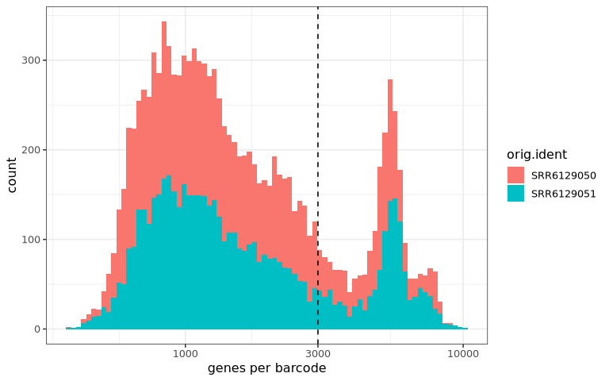

``` r
dge.obj = subset(dge.obj, subset = nFeature_RNA >= 3000 & percent.mt < 10)

dge.obj = dge.obj %>% NormalizeData(verbose = F) %>% FindVariableFeatures(nfeatures = 3000, verbose = F) %>%
    ScaleData(verbose = F) %>% RunPCA(npcs = 30, verbose = F) %>% FindNeighbors(dims = 1:20, verbose = F) %>%
    FindClusters(resolution = 0.5, verbose = F) %>% RunUMAP(dims = 1:20, verbose = F)

#- cell type of each cluster: highest (scaled) marker score...
markers = list(
    "spermatocytes" = c("Sycp3", "Piwil1", "Hormad1", "Spo11", "Ccna1", "Pttg1"),
    "round spermatids" = c("Acrv1", "Spaca1", "Tex36", "Lyar", "Sun5", "Hemgn"),
    "elongating spermatids" = c("Prm1", "Prm2", "Tnp1", "Tnp2", "Oaz3", "Gsg1"),
    "somatic" = c("Sox9", "Amh", "Insl3", "Cyp17a1", "Vim", "Acta2"))
dge.obj = AddModuleScore(dge.obj, features = markers, name = "score")
scores = scale(as.matrix(dge.obj[[]][, paste0("score", seq_along(markers))]))
cl = aggregate(scores, by = list(cluster = dge.obj$seurat_clusters), FUN = mean)
dge.obj$celltype = names(markers)[apply(cl[, -1], 1, which.max)][match(dge.obj$seurat_clusters, cl$cluster)]
table(dge.obj$orig.ident, dge.obj$celltype)
```

                
                 elongating spermatids round spermatids spermatocytes
      SRR6129050                   178              413           564
      SRR6129051                   209              582           469

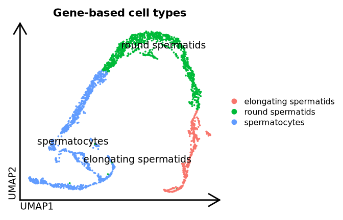

## Downstream analysis of SCALPEL results

### Loading the isoform-based Seurat object

The isoform-based Seurat object generated by SCALPEL has one counts layer per sample and cells named `<sample>_<barcode>` (as the gene-level object above). We keep the cells passing the gene-level quality control:

``` r
idge.obj = readRDS("results/differential/iDGE_seurat.RDS")
#- counts are stored in one layer per sample (Seurat v5): join them
idge.obj = JoinLayers(idge.obj)
#- cells passing the quality control & their cell types from the gene-level analysis...
idge.obj = subset(idge.obj, cells = intersect(colnames(idge.obj), colnames(dge.obj)[dge.obj$celltype != "somatic"]))
idge.obj$celltype = dge.obj$celltype[match(colnames(idge.obj), colnames(dge.obj))]
idge.obj
```

    An object of class Seurat 
    76196 features across 2415 samples within 1 assay 
    Active assay: RNA (76196 features, 0 variable features)
     1 layer present: counts

### Dimensionality reduction and clustering

The isoform quantification can be used as a gene-level count matrix. For the dimensionality reduction only, isoforms detected in less than 10 cells are discarded (all isoforms are kept for the differential isoform usage):

``` r
idge.umap = subset(idge.obj, features = rownames(idge.obj)[Matrix::rowSums(LayerData(idge.obj, layer = "counts") > 0) >= 10])
#- as isoform data is more sparse, we use a higher number of variable features
idge.umap = idge.umap %>% NormalizeData(verbose = F) %>% FindVariableFeatures(nfeatures = 6000, verbose = F) %>%
    ScaleData(verbose = F) %>% RunPCA(npcs = 30, verbose = F) %>% RunUMAP(dims = 1:20, verbose = F)
#- UMAP coordinates & normalized data on the object with all the isoforms...
idge.obj = NormalizeData(idge.obj, verbose = F)
idge.obj[["umap"]] = idge.umap[["umap"]]
DimPlot(idge.obj, group.by = "celltype", label = T, repel = T, pt.size = .5, label.size = 5) %>%
    theme_umap() + ggtitle("iDGE-based UMAP")
```

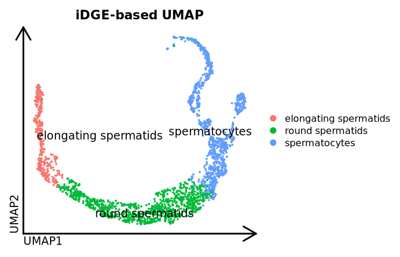

### Differential isoform usage

`scalpelR::FindIsoforms` tests the differential isoform usage between groups of cells with the same method as the pipeline (`differential/DIU_table.csv`, obtained directly with `--clusters`). With more than 2 groups, each group is compared with the rest. We use the permutation test (cells permuted between the groups within each sample) and the SCALPEL isoform annotation (3’ ends):

``` r
diu.table = FindIsoforms(
    seurat_obj = idge.obj,
    group_by = "celltype",
    sample_by = "orig.ident",
    isoform_annotation = "results/isoform",
    test = "permutation",
    cores = 8)
#- genes with a differential isoform usage per comparison...
diu.table %>% distinct(comparison, gene_name, event_type, direction) %>% count(comparison, event_type, direction)
```

                          comparison                event_type   direction     n
                              <char>                    <char>      <char> <int>
    1: elongating spermatids_vs_rest alternative_terminal_exon        <NA>   831
    2: elongating spermatids_vs_rest               tandem_3UTR lengthening    81
    3: elongating spermatids_vs_rest               tandem_3UTR  shortening   274
    4:      round spermatids_vs_rest alternative_terminal_exon        <NA>  1044
    5:      round spermatids_vs_rest               tandem_3UTR lengthening   140
    6:      round spermatids_vs_rest               tandem_3UTR  shortening   246
    7:         spermatocytes_vs_rest alternative_terminal_exon        <NA>  1365
    8:         spermatocytes_vs_rest               tandem_3UTR lengthening   389
    9:         spermatocytes_vs_rest               tandem_3UTR  shortening   125

The table has one row per isoform of the genes with a differential isoform usage (adjusted p-value \< 0.05, usage change \>= 0.1, change in the same direction in both mice), with its counts and usage (`PU`) in each group (`group1`: round spermatids, `group2`: rest). The main columns, for the genes replicated in both mice:

``` r
#- main columns of the table (all the columns are described in the pipeline output documentation)
main_cols = c("gene_name", "transcript_name", "counts.group1", "counts.group2", "PU.group1", "PU.group2", "event_type", "direction", "p.value.adjusted")
diu.table %>% filter(comparison == "round spermatids_vs_rest", replicated == TRUE, counts.group1 + counts.group2 > 0) %>%
    select(all_of(main_cols)) %>%
    mutate(counts.group1 = round(counts.group1), counts.group2 = round(counts.group2), p.value.adjusted = format(p.value.adjusted, digits = 2)) %>%
    head(10) %>% knitr::kable(digits = 2)
```

| gene_name | transcript_name | counts.group1 | counts.group2 | PU.group1 | PU.group2 | event_type | direction | p.value.adjusted |
|:---|:---|---:|---:|---:|---:|:---|:---|:---|
| Ankmy1 | Ankmy1-201 | 2 | 0 | 0.01 | 0.00 | alternative_terminal_exon | NA | 0.00036 |
| Ankmy1 | Ankmy1-202 | 302 | 65 | 0.84 | 0.14 | alternative_terminal_exon | NA | 0.00036 |
| Ankmy1 | Ankmy1-203 | 56 | 390 | 0.15 | 0.86 | alternative_terminal_exon | NA | 0.00036 |
| Aldh1l1 | Aldh1l1-205 | 0 | 2 | 0.00 | 0.03 | tandem_3UTR | lengthening | 0.00036 |
| Aldh1l1 | Aldh1l1-204 | 2 | 1 | 0.04 | 0.02 | tandem_3UTR | lengthening | 0.00036 |
| Aldh1l1 | Aldh1l1-201 | 5 | 49 | 0.09 | 0.78 | tandem_3UTR | lengthening | 0.00036 |
| Aldh1l1 | Aldh1l1-203 | 46 | 11 | 0.87 | 0.17 | tandem_3UTR | lengthening | 0.00036 |
| Brca2 | Brca2-209 | 0 | 5 | 0.00 | 0.00 | alternative_terminal_exon | NA | 0.00036 |
| Brca2 | Brca2-202 | 8 | 55 | 0.01 | 0.04 | alternative_terminal_exon | NA | 0.00036 |
| Brca2 | Brca2-203 | 11 | 112 | 0.01 | 0.08 | alternative_terminal_exon | NA | 0.00036 |

The tandem 3’ UTR events (isoforms sharing their terminal exon) give the direction of the 3’ UTR changes: shorter 3’ UTRs in round and elongating spermatids, longer 3’ UTRs in spermatocytes, as described for the global 3’ UTR shortening during spermatogenesis:

``` r
#- genes with a tandem 3' UTR change per cell type: shortening (left) & lengthening (right)...
dir.tab = diu.table %>% filter(event_type == "tandem_3UTR") %>% distinct(comparison, gene_name, direction) %>%
    count(comparison, direction) %>% group_by(comparison) %>% mutate(frac = n / sum(n)) %>% ungroup() %>%
    mutate(celltype = factor(sub("_vs_rest", "", comparison), levels = rev(c("spermatocytes", "round spermatids", "elongating spermatids"))),
           x = ifelse(direction == "shortening", -n, n))
xmax = max(abs(dir.tab$x)) * 1.35
ggplot(dir.tab, aes(x, celltype, fill = direction)) +
    geom_col(width = .62, color = "black", linewidth = .25) +
    geom_vline(xintercept = 0, linewidth = .6) +
    geom_text(aes(label = paste0(n, " (", round(100 * frac), "%)"), hjust = ifelse(x < 0, 1.12, -.12)), size = 3.8) +
    annotate("text", x = c(-xmax, xmax) * .97, y = 3.62, label = c("\u2190 shorter 3' UTRs", "longer 3' UTRs \u2192"),
             hjust = c(0, 1), color = c("#2166AC", "#B2182B"), fontface = "bold", size = 4.2) +
    scale_fill_manual(values = c(shortening = "#2166AC", lengthening = "#B2182B"), guide = "none") +
    scale_x_continuous(limits = c(-xmax, xmax), labels = abs) +
    scale_y_discrete(expand = expansion(add = c(.5, .85))) +
    labs(x = "genes with a tandem 3' UTR change", y = NULL, title = "3' UTR changes vs the other cell types") +
    theme_minimal(base_size = 13) +
    theme(panel.grid.major.y = element_blank(), panel.grid.minor = element_blank(), axis.text.y = element_text(color = "black"),
          plot.title = element_text(face = "bold"))
```

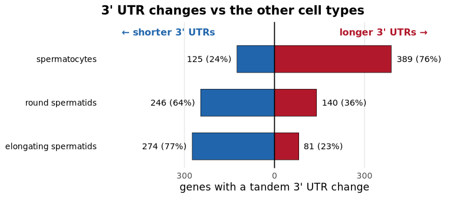

### Isoform usage of a gene

For example, the gene **Mdm2** switches from its distal 3’ end (Mdm2-201, long 3’ UTR) in spermatocytes to a proximal 3’ end (Mdm2-205, short 3’ UTR) in round and elongating spermatids, in both mice:

``` r
diu.table %>% filter(gene_name == "Mdm2", comparison == "round spermatids_vs_rest", counts.group1 + counts.group2 > 0) %>%
    select(all_of(main_cols)) %>%
    mutate(counts.group1 = round(counts.group1), counts.group2 = round(counts.group2), p.value.adjusted = format(p.value.adjusted, digits = 2)) %>%
    knitr::kable(digits = 2)
```

| gene_name | transcript_name | counts.group1 | counts.group2 | PU.group1 | PU.group2 | event_type | direction | p.value.adjusted |
|:---|:---|---:|---:|---:|---:|:---|:---|:---|
| Mdm2 | Mdm2-208 | 22 | 16 | 0.00 | 0.00 | tandem_3UTR | shortening | 0.00036 |
| Mdm2 | Mdm2-207 | 29 | 32 | 0.01 | 0.01 | tandem_3UTR | shortening | 0.00036 |
| Mdm2 | Mdm2-203 | 11 | 19 | 0.00 | 0.00 | tandem_3UTR | shortening | 0.00036 |
| Mdm2 | Mdm2-206 | 15 | 10 | 0.00 | 0.00 | tandem_3UTR | shortening | 0.00036 |
| Mdm2 | Mdm2-204 | 856 | 740 | 0.18 | 0.15 | tandem_3UTR | shortening | 0.00036 |
| Mdm2 | Mdm2-205 | 2336 | 819 | 0.48 | 0.17 | tandem_3UTR | shortening | 0.00036 |
| Mdm2 | Mdm2-201 | 1567 | 3301 | 0.32 | 0.67 | tandem_3UTR | shortening | 0.00036 |

`scalpelR::plotUsage` shows the usage of each isoform in each group of cells (bars: cells of the two mice, points: each mouse):

``` r
plotUsage(idge.obj, gene_in = "Mdm2", group_by = "celltype", sample_by = "orig.ident", isoform_annotation = "results/isoform",
    groups = c("spermatocytes", "round spermatids", "elongating spermatids"))
```

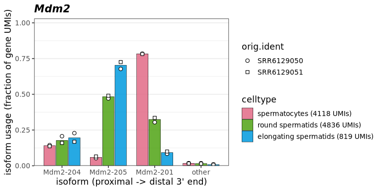

The expression of its two most changing isoforms can also be visualized on the UMAP:

``` r
mdm2 = diu.table %>% filter(gene_name == "Mdm2", comparison == "round spermatids_vs_rest") %>% arrange(-abs(delta_PU)) %>% head(2)
FeaturePlot(idge.obj, features = mdm2$gene.tr, order = T, pt.size = .5, cols = c("gray85", "red"))
```

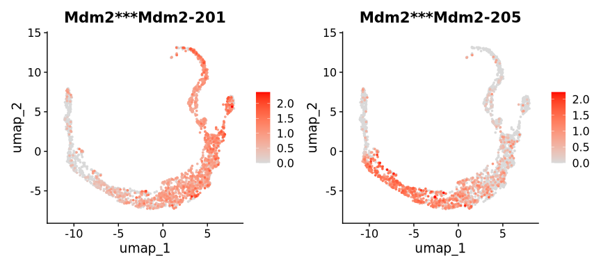

### Read coverage

`scalpelR::CoveragePlot` plots the coverage of the reads used by SCALPEL (`filtered_bams`) for each group of cells, normalized by the number of cells, with the structure of the isoforms (thick: CDS, thin: UTR, arrows: strand):

``` r
gtf = rtracklayer::import("refs/gencode.vM23.annotation.gtf.gz")
bams = c(SRR6129050 = "results/filtered_bams/SRR6129050_filtered.bam", SRR6129051 = "results/filtered_bams/SRR6129051_filtered.bam")
CoveragePlot(idge.obj, bamfiles = bams, gene_in = "Mdm2", genome_gr = gtf, group_by = "celltype",
    groups = c("spermatocytes", "round spermatids", "elongating spermatids"), distZOOM = 6000, extend = 500)
```

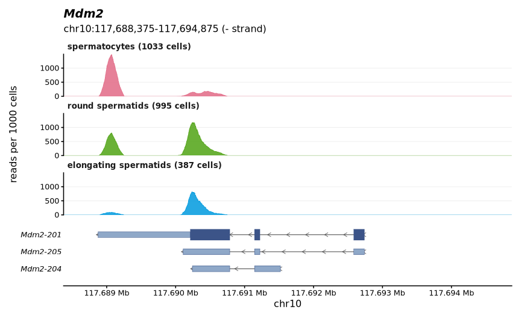

Isoform switches between alternative terminal exons are also detected (no 3’ UTR direction: the isoforms end in different exons), e.g. the most supported one in round spermatids, replicated in both mice:

``` r
alt_gene = diu.table %>% filter(comparison == "round spermatids_vs_rest", event_type == "alternative_terminal_exon", replicated == TRUE) %>%
    distinct(gene_name, max_delta_PU, umis.group1, umis.group2) %>% arrange(-pmin(umis.group1, umis.group2) * max_delta_PU) %>% pull(gene_name) %>% head(1)
alt_gene
```

    [1] "Psmd8"

``` r
plotUsage(idge.obj, gene_in = alt_gene, group_by = "celltype", sample_by = "orig.ident", isoform_annotation = "results/isoform",
    groups = c("spermatocytes", "round spermatids", "elongating spermatids"))
```

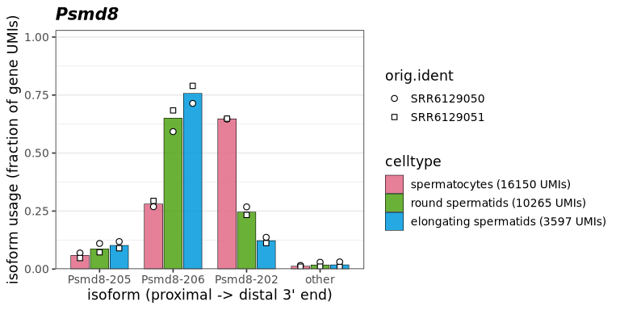

To browse the reads of a cell population (e.g. IGV), `scalpelR::subsetBAM` writes the reads of selected cells (barcodes as in the BAM `CB` tag, column `Barcodes`):

``` r
rs_barcodes = idge.obj[[]] %>% filter(celltype == "round spermatids", orig.ident == "SRR6129050") %>% pull(Barcodes)
subsetBAM(bam_file = bams[["SRR6129050"]], barcodes = rs_barcodes, output_file = "SRR6129050_round_spermatids.bam", tag = "CB", cores = 4)
```

### 3’ UTR length in single cells

Using the isoform quantification and the genome annotation (3’ UTR of each transcript), `scalpelR::weightedUTR_cell` computes for each gene and cell the weighted 3’ UTR length (isoform usage x isoform 3’ UTR length), for the genes whose isoforms differ in 3’ UTR length. Each gene is compared with its weighted 3’ UTR length in all the cells, and the differences are averaged over the genes of the cell (nt; \> 0: longer, \< 0: shorter 3’ UTRs than the average cell). As each gene is compared with itself, the value does not depend on which genes are detected in the cell (sequencing depth):

``` r
utr3length_tab = weightedUTR_cell(
    seurat_obj = idge.obj,
    annotation_gr = gtf,
    group.by = "celltype") %>%
    mutate(group = factor(group, levels = c("spermatocytes", "round spermatids", "elongating spermatids")))
head(utr3length_tab, 5)
```

                               cells            group wUTRlength.cell n_genes
                              <char>           <fctr>           <num>   <int>
    1: SRR6129050_AAACCTGAGCTTATCG-1 round spermatids       -21.34790    1681
    2: SRR6129050_AAACCTGGTTGAGTTC-1 round spermatids       -18.69781    1569
    3: SRR6129050_AAACCTGTCAACGAAA-1 round spermatids       -41.74953    1499
    4: SRR6129050_AAACCTGTCTCATTCA-1    spermatocytes        42.46814     987
    5: SRR6129050_AAACGGGCACAGGTTT-1 round spermatids       -49.56902    1690

The 3’ UTR length of each cell (points) per cell type, and along the differentiation on the UMAP:

``` r
lv = c("spermatocytes", "round spermatids", "elongating spermatids")
cols = setNames(grDevices::hcl.colors(3, "Dark 3"), lv)
med = utr3length_tab %>% group_by(group) %>% summarise(m = median(wUTRlength.cell))
#- y range: 99% of the cells...
yl = quantile(utr3length_tab$wUTRlength.cell, c(.005, .995), na.rm = T)
#- per cell type: cells (jitter) & distribution (boxplot)...
p1 = utr3length_tab %>%
    ggplot(aes(x = group, y = wUTRlength.cell)) +
    geom_jitter(aes(color = group), width = .25, size = .6, alpha = .5) +
    geom_boxplot(fill = NA, width = .35, outlier.shape = NA, linewidth = .6) +
    geom_text(data = med, aes(x = group, y = yl[2] + diff(yl) * .08, label = sprintf("%+.0f nt", m)), size = 4) +
    scale_color_manual(values = cols) + scale_x_discrete(labels = function(x) sub(" ", "\n", x)) +
    geom_hline(yintercept = 0, linetype = 2, color = "gray40") +
    coord_cartesian(ylim = c(yl[1], yl[2] + diff(yl) * .12)) +
    xlab(NULL) + ylab("3' UTR length vs average cell (nt)") +
    ggtitle("3' UTR length per cell") +
    theme_bw(base_size = 13) + theme(legend.position = "none", panel.grid.major.x = element_blank())
#- on the UMAP (blue: shorter, red: longer 3' UTRs than the average cell)...
idge.obj$wUTRlength = utr3length_tab$wUTRlength.cell[match(colnames(idge.obj), utr3length_tab$cells)]
lim = quantile(abs(idge.obj$wUTRlength), .98, na.rm = T)
p2 = FeaturePlot(idge.obj, features = "wUTRlength", pt.size = .6, order = F) %>% theme_umap() +
    scale_color_gradientn(colors = rev(RColorBrewer::brewer.pal(11, "RdBu")), limits = c(-lim, lim), oob = scales::squish,
                          name = "3' UTR length\nvs average\ncell (nt)") +
    guides(color = guide_colorbar(barheight = unit(5, "cm"))) +
    ggtitle("3' UTR length along the differentiation") +
    theme(plot.title = element_text(face = "plain", hjust = 0, size = 15))
patchwork::wrap_plots(p1, p2, ncol = 2, widths = c(1, 1.1))
```

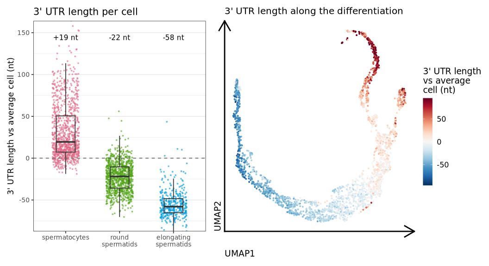

The 3’ UTRs shorten progressively along the spermatogenesis: longer than the average cell in spermatocytes, shorter in round and even shorter in elongating spermatids, also visible within each cell type on the UMAP.

### Global 3’ UTR shifts

`scalpelR::plotShiftHeatmap` summarizes the 3’ UTR changes of many genes: for each gene, the relative 3’ UTR length (usage of its isoforms weighted by their 3’ UTR length, from 0: shortest to 1: longest isoform) in each group of cells, scaled per gene (blue: shorter, red: longer 3’ UTR than the gene mean; one column per group and sample with `sample_by`). Here, the 100 most variable genes with a tandem 3’ UTR event, split in 3 clusters:

``` r
p.shift = plotShiftHeatmap(idge.obj, annotation_gr = gtf, group_by = "celltype",
    groups = c("spermatocytes", "round spermatids", "elongating spermatids"), genes = diu.table, n_clusters = 3)
p.shift
```

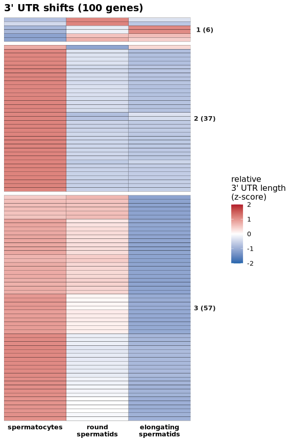

The genes of each cluster (e.g. early or late 3’ UTR shortening) are in the table of the plot:

``` r
attr(p.shift, "shift") %>% distinct(cluster, gene_name) %>% group_by(cluster) %>%
    summarise(genes = n(), examples = paste(head(as.character(gene_name), 8), collapse = ", ")) %>% knitr::kable()
```

| cluster | genes | examples |
|:---|---:|:---|
| 1 (6) | 6 | Aldh1l1, Setd3, Gm9999, Abhd10, Got1, Dazl |
| 2 (37) | 37 | Grb10, Cpeb4, Tgfbr1, Fam168a, Mpzl1, Gab2, Smg7, Gramd1c |
| 3 (57) | 57 | Tmem185a, Arhgap19, Mllt11, Tmem178b, Eif4a2, Ect2, 4930503L19Rik, Ccnyl1 |

With a pseudotime (here computed with [slingshot](https://bioconductor.org/packages/slingshot) on the gene-level PCA, from the spermatocytes), the cells are ordered along the differentiation and pooled in bins of the same number of cells (`order_by`):

``` r
germ = subset(dge.obj, subset = celltype != "somatic")
sl = slingshot::slingshot(Embeddings(germ, "pca")[, 1:20], clusterLabels = germ$celltype, start.clus = "spermatocytes")
idge.obj$pseudotime = slingshot::slingPseudotime(sl)[match(colnames(idge.obj), colnames(germ)), 1]
```

``` r
plotShiftHeatmap(idge.obj, annotation_gr = gtf, group_by = "celltype", order_by = "pseudotime", n_bins = 30,
    groups = c("spermatocytes", "round spermatids", "elongating spermatids"), genes = diu.table, n_clusters = 3)
```

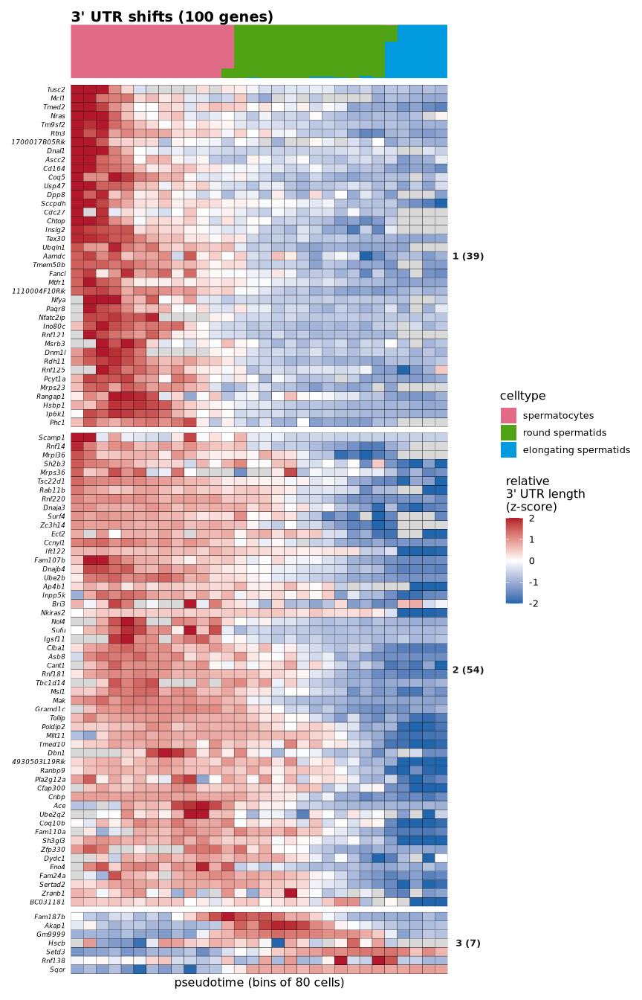

## Further downstream analysis

The isoform-based Seurat object can be used as a standard gene-based Seurat object (e.g. trajectory analysis with Monocle3). For more information, see the [Seurat documentation](https://satijalab.org/seurat/).
