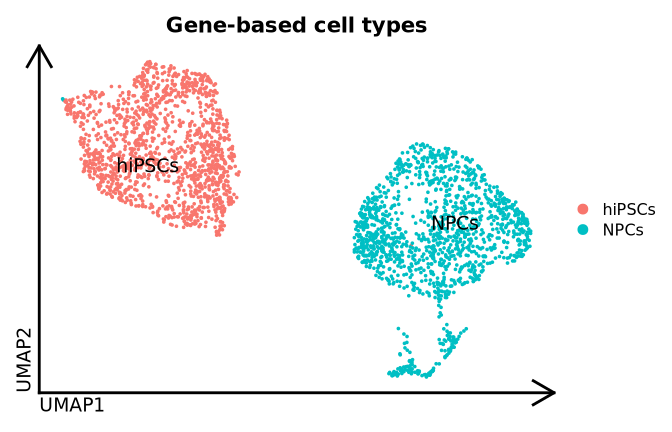
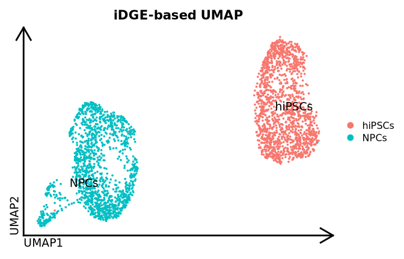
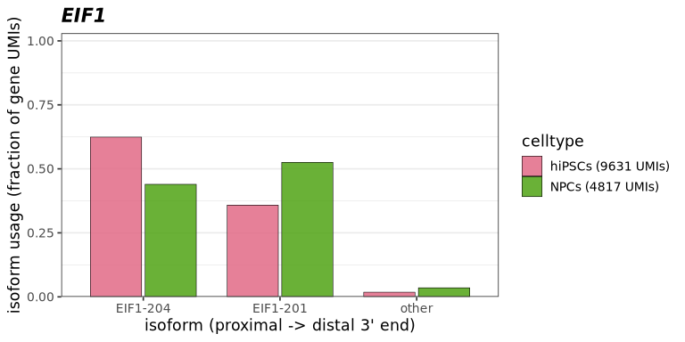
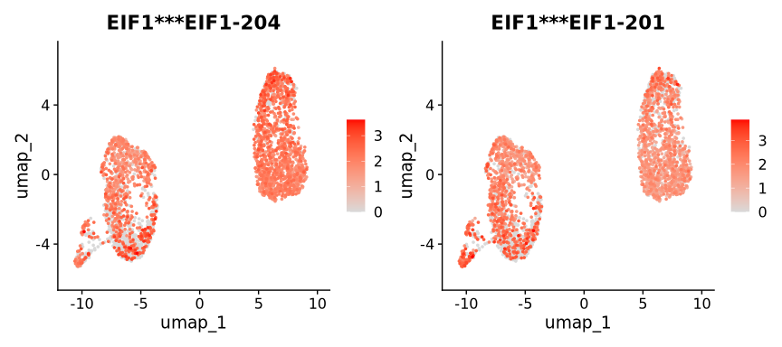
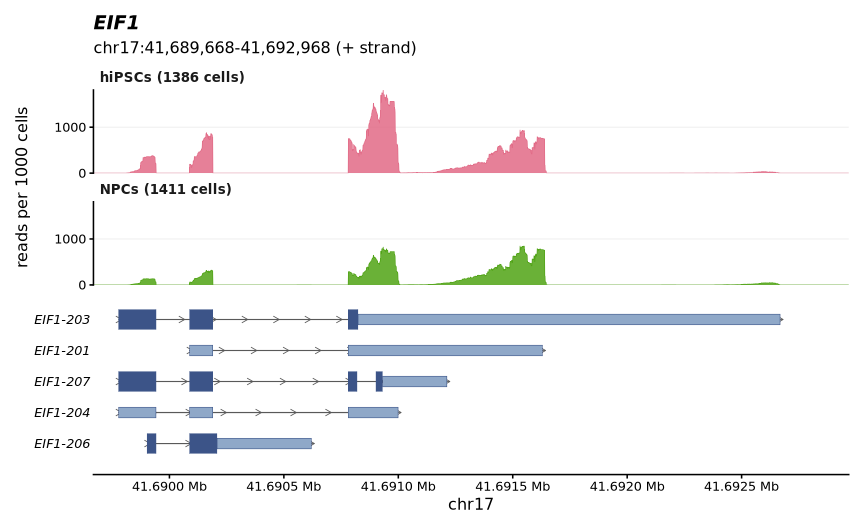
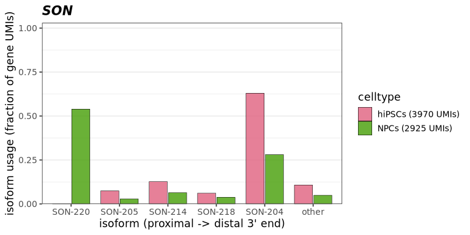
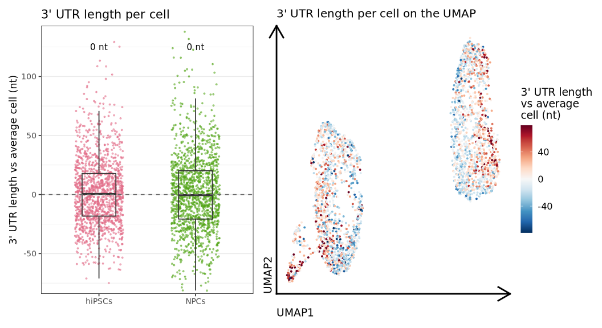
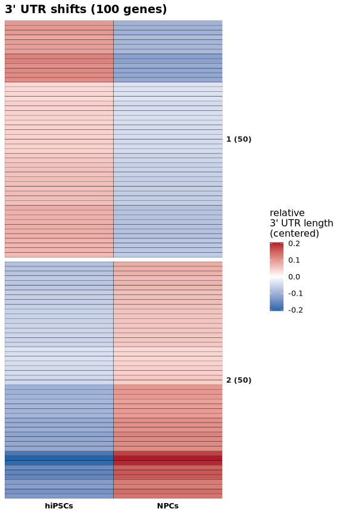

# Downstream analysis on Drop-seq scRNA-seq from human neuronal differentiation using SCALPEL


``` r
suppressPackageStartupMessages(library(Seurat, quietly = TRUE))
suppressPackageStartupMessages(library(dplyr, quietly = TRUE))
suppressPackageStartupMessages(library(data.table, quietly = TRUE))
suppressPackageStartupMessages(library(ggplot2, quietly = TRUE))
suppressPackageStartupMessages(library(scalpelR, quietly = TRUE))
```

The functions used in this downstream analysis are provided by the R package scalpelR, installed from its [Github page](https://github.com/Franzx7/scalpelR):

``` r
install.packages("remotes")
remotes::install_github("Franzx7/scalpelR@dev")
library(scalpelR)
```

| Function | Use |
|----|----|
| `FindIsoforms` | Differential isoform usage between groups of cells (same method as the pipeline DIU table). |
| `plotUsage` | Isoform usage (fraction of the gene) per group and sample. |
| `CoveragePlot` | Read coverage of a gene per group of cells, from the SCALPEL filtered BAM files. |
| `weightedUTR_cell` | Weighted 3’ UTR length per cell. |
| `plotShiftHeatmap` | Heatmap of the 3’ UTR shifts of the genes between groups of cells or along a trajectory. |
| `subsetBAM` | BAM file of the reads of selected cells (e.g. genome browser). |

## Introduction

In this example, we perform a gene and isoform level single-cell analysis of the Drop-seq dataset of human neuronal differentiation from [Franz Ake et al](https://www.biorxiv.org/content/10.1101/2024.06.21.600022v1) ([GSE268222](https://www.ncbi.nlm.nih.gov/geo/query/acc.cgi?acc=GSE268222)): human induced pluripotent stem cells (hiPSCs) and neural progenitor cells (NPCs) derived from them, one Drop-seq library each (1,600 cells per library). The BAM files and the gene count matrices were obtained with the [Drop-seq tools](https://github.com/broadinstitute/Drop-seq) (GRCh38, GENCODE v41), and SCALPEL was run with the default parameters on the full dataset:

``` sh
nextflow run plasslab/nf-core-scalpel -r dev -profile singularity \
    --sequencing_platform dropseq \
    --samplesheet samplesheet.csv \
    --transcriptome gencode.v41.transcripts.fa.gz \
    --gtf gencode.v41.annotation.gtf.gz \
    --genome GRCh38.primary_assembly.genome.fa.gz \
    --outdir results
```

``` sh
> cat samplesheet.csv
sample,fastq_1,fastq_2,cranger_path,dge
hiPSCs,iPSC3_lib_16058AAB_CTCTCTAC_read1_001.fastq.gz,iPSC3_lib_16058AAB_CTCTCTAC_read2_001.fastq.gz,dropseq_files/hiPSCs.bam,dropseq_files/hiPSCs.counts.txt
NPCs,NPC3_lib_16057AAB_TAGGCATG_read1_001.fastq.gz,NPC3_lib_16057AAB_TAGGCATG_read2_001.fastq.gz,dropseq_files/NPCs.bam,dropseq_files/NPCs.counts.txt
```

The run took 39 min (2 samples, 64 CPUs). The files used by this downstream analysis are:

``` sh
> tree results/differential results/filtered_bams results/isoform -L 1
results/differential
├── DIU_table.csv
├── DIU_warnings.txt
├── iDGE_seurat.RDS
└── samples_qc.tsv
results/filtered_bams
├── hiPSCs_filtered.bam
├── hiPSCs_filtered.bam.bai
├── NPCs_filtered.bam
└── NPCs_filtered.bam.bai
results/isoform
├── chr1.annots.gz
...
```

> [!IMPORTANT]
>
> **One library per condition.** Without `--clusters`, the pipeline compares the two samples (`differential/DIU_table.csv`, hiPSCs vs NPCs). With a single library per condition, biological and technical (batch) differences between the libraries cannot be separated, and the replication of the changes cannot be assessed (`replicated` NA). The libraries are similar here (median read distance to the 3’ ends of 91 and 88 nt, `differential/samples_qc.tsv`); replicates (several libraries per condition) are recommended to confirm the changes.

## Gene-level analysis: cell types

We first annotate the cells with a standard gene-level analysis of the Drop-seq count matrices. The 1,600 barcodes of each library were already selected; we discard the few barcodes with less than 500 genes, more than 5% mitochondrial reads or more than 25,000 UMIs (doublets).

``` r
#- Drop-seq gene counts of the two samples...
dge.obj = lapply(c("hiPSCs", "NPCs"), function(s){
    m = fread(file.path("dropseq_files", paste0(s, ".counts.txt")))
    x = Matrix::Matrix(as.matrix(m[, -1]), sparse = T, dimnames = list(m$GENE, colnames(m)[-1]))
    o = CreateSeuratObject(x, project = s)
    o$orig.ident = s
    o$Barcodes = colnames(o)
    o
})
dge.obj = merge(dge.obj[[1]], dge.obj[[2]], add.cell.ids = c("hiPSCs", "NPCs")) %>% JoinLayers()

#- quality control...
dge.obj[["percent.mt"]] = PercentageFeatureSet(dge.obj, pattern = "^MT-")
dge.obj = subset(dge.obj, subset = nFeature_RNA >= 500 & percent.mt < 5 & nCount_RNA < 25000)

dge.obj = dge.obj %>% NormalizeData(verbose = F) %>% FindVariableFeatures(nfeatures = 3000, verbose = F) %>%
    ScaleData(verbose = F) %>% RunPCA(npcs = 30, verbose = F) %>% FindNeighbors(dims = 1:20, verbose = F) %>%
    FindClusters(resolution = 0.3, verbose = F) %>% RunUMAP(dims = 1:20, verbose = F)

#- cell type of each cluster: highest (scaled) marker score...
markers = list(
    "hiPSCs" = c("POU5F1", "DPPA4", "LIN28A", "TDGF1", "L1TD1"),
    "NPCs" = c("PAX6", "NES", "VIM", "HES5", "SOX2"))
dge.obj = AddModuleScore(dge.obj, features = markers, name = "score")
scores = scale(as.matrix(dge.obj[[]][, paste0("score", seq_along(markers))]))
cl = aggregate(scores, by = list(cluster = dge.obj$seurat_clusters), FUN = mean)
dge.obj$celltype = names(markers)[apply(cl[, -1], 1, which.max)][match(dge.obj$seurat_clusters, cl$cluster)]
table(dge.obj$orig.ident, dge.obj$celltype)
```

            
             hiPSCs NPCs
      hiPSCs   1386    5
      NPCs        0 1406

The marker-based cell types match the two libraries:



## Downstream analysis of SCALPEL results

### Loading the isoform-based Seurat object

The isoform-based Seurat object generated by SCALPEL has one counts layer per sample and cells named `<sample>_<barcode>` (as the gene-level object above). We keep the cells passing the gene-level quality control:

``` r
idge.obj = readRDS("results/differential/iDGE_seurat.RDS")
#- counts are stored in one layer per sample (Seurat v5): join them
idge.obj = JoinLayers(idge.obj)
#- cells passing the quality control & their cell types from the gene-level analysis...
idge.obj = subset(idge.obj, cells = intersect(colnames(idge.obj), colnames(dge.obj)))
idge.obj$celltype = dge.obj$celltype[match(colnames(idge.obj), colnames(dge.obj))]
idge.obj
```

    An object of class Seurat 
    98202 features across 2797 samples within 1 assay 
    Active assay: RNA (98202 features, 0 variable features)
     1 layer present: counts

### Dimensionality reduction and clustering

The isoform quantification can be used as a gene-level count matrix. For the dimensionality reduction only, isoforms detected in less than 10 cells are discarded (all isoforms are kept for the differential isoform usage):

``` r
idge.umap = subset(idge.obj, features = rownames(idge.obj)[Matrix::rowSums(LayerData(idge.obj, layer = "counts") > 0) >= 10])
#- as isoform data is more sparse, we use a higher number of variable features
idge.umap = idge.umap %>% NormalizeData(verbose = F) %>% FindVariableFeatures(nfeatures = 6000, verbose = F) %>%
    ScaleData(verbose = F) %>% RunPCA(npcs = 30, verbose = F) %>% RunUMAP(dims = 1:20, verbose = F)
#- UMAP coordinates & normalized data on the object with all the isoforms...
idge.obj = NormalizeData(idge.obj, verbose = F)
idge.obj[["umap"]] = idge.umap[["umap"]]
DimPlot(idge.obj, group.by = "celltype", label = T, repel = T, pt.size = .5, label.size = 5) %>%
    theme_umap() + ggtitle("iDGE-based UMAP")
```



### Differential isoform usage

`scalpelR::FindIsoforms` tests the differential isoform usage between groups of cells with the same method as the pipeline (`differential/DIU_table.csv`, here also hiPSCs vs NPCs). We use the permutation test (cells as units) and the SCALPEL isoform annotation (3’ ends):

``` r
diu.table = FindIsoforms(
    seurat_obj = idge.obj,
    group_by = "celltype",
    sample_by = NULL,
    isoform_annotation = "results/isoform",
    test = "permutation",
    cores = 8)
#- genes with a differential isoform usage...
diu.table %>% distinct(comparison, gene_name, event_type, direction) %>% count(comparison, event_type, direction)
```

           comparison                event_type   direction     n
               <char>                    <char>      <char> <int>
    1: hiPSCs_vs_NPCs alternative_terminal_exon        <NA>   940
    2: hiPSCs_vs_NPCs               tandem_3UTR lengthening   119
    3: hiPSCs_vs_NPCs               tandem_3UTR  shortening   105

The table has one row per isoform of the genes with a differential isoform usage (adjusted p-value \< 0.05, usage change \>= 0.1), with its counts and usage (`PU`) in each group (`group1`: hiPSCs, `group2`: NPCs). The main columns, for genes with at least 200 UMIs in each group:

``` r
#- main columns of the table (all the columns are described in the pipeline output documentation)
main_cols = c("gene_name", "transcript_name", "counts.group1", "counts.group2", "PU.group1", "PU.group2", "event_type", "direction", "p.value.adjusted")
diu.table %>% filter(pmin(umis.group1, umis.group2) >= 200, counts.group1 + counts.group2 > 0) %>%
    select(all_of(main_cols)) %>%
    mutate(counts.group1 = round(counts.group1), counts.group2 = round(counts.group2), p.value.adjusted = format(p.value.adjusted, digits = 2)) %>%
    head(10) %>% knitr::kable(digits = 2)
```

| gene_name | transcript_name | counts.group1 | counts.group2 | PU.group1 | PU.group2 | event_type | direction | p.value.adjusted |
|:---|:---|---:|---:|---:|---:|:---|:---|:---|
| ATP5IF1 | ATP5IF1-201 | 379 | 110 | 1.00 | 0.25 | alternative_terminal_exon | NA | 0.00061 |
| ATP5IF1 | ATP5IF1-203 | 0 | 330 | 0.00 | 0.75 | alternative_terminal_exon | NA | 0.00061 |
| SON | SON-215 | 0 | 6 | 0.00 | 0.00 | alternative_terminal_exon | NA | 0.00061 |
| SON | SON-220 | 0 | 1577 | 0.00 | 0.54 | alternative_terminal_exon | NA | 0.00061 |
| SON | SON-203 | 90 | 26 | 0.02 | 0.01 | alternative_terminal_exon | NA | 0.00061 |
| SON | SON-201 | 88 | 43 | 0.02 | 0.01 | alternative_terminal_exon | NA | 0.00061 |
| SON | SON-205 | 296 | 84 | 0.07 | 0.03 | alternative_terminal_exon | NA | 0.00061 |
| SON | SON-214 | 505 | 188 | 0.13 | 0.06 | alternative_terminal_exon | NA | 0.00061 |
| SON | SON-206 | 3 | 0 | 0.00 | 0.00 | alternative_terminal_exon | NA | 0.00061 |
| SON | SON-218 | 244 | 110 | 0.06 | 0.04 | alternative_terminal_exon | NA | 0.00061 |

The tandem 3’ UTR events (isoforms sharing their terminal exon) give the direction of the 3’ UTR changes (`lengthening`: longer 3’ UTRs in hiPSCs than in NPCs, `shortening`: shorter); the alternative terminal exon events have no direction:

``` r
diu.table %>% distinct(gene_name, event_type, direction) %>% count(event_type, direction) %>% knitr::kable()
```

| event_type                | direction   |   n |
|:--------------------------|:------------|----:|
| alternative_terminal_exon | NA          | 940 |
| tandem_3UTR               | lengthening | 119 |
| tandem_3UTR               | shortening  | 105 |

### Isoform usage of a gene

For example, the gene **EIF1** uses more its isoform with the shorter 3’ UTR (EIF1-204) in hiPSCs than in NPCs:

``` r
diu.table %>% filter(gene_name == "EIF1", counts.group1 + counts.group2 > 0) %>%
    select(all_of(main_cols)) %>%
    mutate(counts.group1 = round(counts.group1), counts.group2 = round(counts.group2), p.value.adjusted = format(p.value.adjusted, digits = 2)) %>%
    knitr::kable(digits = 2)
```

| gene_name | transcript_name | counts.group1 | counts.group2 | PU.group1 | PU.group2 | event_type | direction | p.value.adjusted |
|:---|:---|---:|---:|---:|---:|:---|:---|:---|
| EIF1 | EIF1-206 | 0 | 2 | 0.00 | 0.00 | tandem_3UTR | shortening | 0.00061 |
| EIF1 | EIF1-204 | 6010 | 2117 | 0.62 | 0.44 | tandem_3UTR | shortening | 0.00061 |
| EIF1 | EIF1-207 | 107 | 77 | 0.01 | 0.02 | tandem_3UTR | shortening | 0.00061 |
| EIF1 | EIF1-201 | 3446 | 2530 | 0.36 | 0.53 | tandem_3UTR | shortening | 0.00061 |
| EIF1 | EIF1-203 | 67 | 91 | 0.01 | 0.02 | tandem_3UTR | shortening | 0.00061 |

`scalpelR::plotUsage` shows the usage of each isoform in each group of cells:

``` r
lv = c("hiPSCs", "NPCs")
plotUsage(idge.obj, gene_in = "EIF1", group_by = "celltype", isoform_annotation = "results/isoform", groups = lv)
```



The expression of its two most changing isoforms can also be visualized on the UMAP:

``` r
eif1 = diu.table %>% filter(gene_name == "EIF1") %>% arrange(-abs(delta_PU)) %>% head(2)
FeaturePlot(idge.obj, features = eif1$gene.tr, order = T, pt.size = .5, cols = c("gray85", "red"))
```



### Read coverage

`scalpelR::CoveragePlot` plots the coverage of the reads used by SCALPEL (`filtered_bams`) for each group of cells, normalized by the number of cells, with the structure of the isoforms (thick: CDS, thin: UTR, arrows: strand). For Drop-seq, the cell barcodes are in the `XC` tag of the BAM files:

``` r
gtf = rtracklayer::import("refs/gencode.v41.annotation.gtf")
bams = c(hiPSCs = "results/filtered_bams/hiPSCs_filtered.bam", NPCs = "results/filtered_bams/NPCs_filtered.bam")
CoveragePlot(idge.obj, bamfiles = bams, gene_in = "EIF1", genome_gr = gtf, group_by = "celltype", tag = "XC",
    groups = lv, distZOOM = 3000, extend = 300)
```



Isoform switches between alternative terminal exons are also detected (no 3’ UTR direction: the isoforms end in different exons), e.g. the most supported one:

``` r
alt_gene = diu.table %>% filter(event_type == "alternative_terminal_exon", switch == TRUE) %>%
    distinct(gene_name, max_delta_PU, umis.group1, umis.group2) %>% arrange(-pmin(umis.group1, umis.group2) * max_delta_PU) %>% pull(gene_name) %>% head(1)
alt_gene
```

    [1] "SON"

``` r
plotUsage(idge.obj, gene_in = alt_gene, group_by = "celltype", isoform_annotation = "results/isoform", groups = lv)
```



To browse the reads of a cell population (e.g. IGV), `scalpelR::subsetBAM` writes the reads of selected cells (barcodes as in the BAM `XC` tag, column `Barcodes`):

``` r
#- e.g. the NPCs of one gene-level cluster...
npc_barcodes = dge.obj[[]] %>% filter(celltype == "NPCs", seurat_clusters == "1") %>% pull(Barcodes)
subsetBAM(bam_file = bams[["NPCs"]], barcodes = npc_barcodes, output_file = "NPCs_cluster1.bam", tag = "XC", cores = 4)
```

### 3’ UTR length in single cells

Using the isoform quantification and the genome annotation (3’ UTR of each transcript), `scalpelR::weightedUTR_cell` computes for each gene and cell the weighted 3’ UTR length (isoform usage x isoform 3’ UTR length), for the genes whose isoforms differ in 3’ UTR length. Each gene is compared with its weighted 3’ UTR length in all the cells, and the differences are averaged over the genes of the cell (nt; \> 0: longer, \< 0: shorter 3’ UTRs than the average cell). As each gene is compared with itself, the value does not depend on which genes are detected in the cell (sequencing depth):

``` r
utr3length_tab = weightedUTR_cell(
    seurat_obj = idge.obj,
    annotation_gr = gtf,
    group.by = "celltype") %>%
    mutate(group = factor(group, levels = lv))
head(utr3length_tab, 5)
```

                     cells  group wUTRlength.cell n_genes
                    <char> <fctr>           <num>   <int>
    1: hiPSCs_AAAAAAGAACCC hiPSCs       -8.632196    1244
    2: hiPSCs_AAAAAAGAACTG hiPSCs       -8.751165     831
    3: hiPSCs_AAAAAATGTAAC hiPSCs      -10.386375     979
    4: hiPSCs_AAAAGAATCGGC hiPSCs      -12.311663     702
    5: hiPSCs_AAAAGTCAACTA hiPSCs       16.977320    1400

The 3’ UTR length of each cell (points) per cell type, and on the UMAP:

``` r
cols = setNames(grDevices::hcl.colors(3, "Dark 3"), lv)
med = utr3length_tab %>% group_by(group) %>% summarise(m = median(wUTRlength.cell, na.rm = T))
#- y range: 99% of the cells...
yl = quantile(utr3length_tab$wUTRlength.cell, c(.005, .995), na.rm = T)
#- per cell type: cells (jitter) & distribution (boxplot)...
p1 = utr3length_tab %>%
    ggplot(aes(x = group, y = wUTRlength.cell)) +
    geom_jitter(aes(color = group), width = .25, size = .6, alpha = .5) +
    geom_boxplot(fill = NA, width = .35, outlier.shape = NA, linewidth = .6) +
    geom_text(data = med, aes(x = group, y = yl[2] + diff(yl) * .08, label = ifelse(round(m) == 0, "0 nt", sprintf("%+.0f nt", m))), size = 4) +
    scale_color_manual(values = cols) +
    geom_hline(yintercept = 0, linetype = 2, color = "gray40") +
    coord_cartesian(ylim = c(yl[1], yl[2] + diff(yl) * .12)) +
    xlab(NULL) + ylab("3' UTR length vs average cell (nt)") +
    ggtitle("3' UTR length per cell") +
    theme_bw(base_size = 13) + theme(legend.position = "none", panel.grid.major.x = element_blank())
#- on the UMAP (blue: shorter, red: longer 3' UTRs than the average cell)...
idge.obj$wUTRlength = utr3length_tab$wUTRlength.cell[match(colnames(idge.obj), utr3length_tab$cells)]
lim = quantile(abs(idge.obj$wUTRlength), .98, na.rm = T)
p2 = FeaturePlot(idge.obj, features = "wUTRlength", pt.size = .6, order = F) %>% theme_umap() +
    scale_color_gradientn(colors = rev(RColorBrewer::brewer.pal(11, "RdBu")), limits = c(-lim, lim), oob = scales::squish,
                          name = "3' UTR length\nvs average\ncell (nt)") +
    guides(color = guide_colorbar(barheight = unit(5, "cm"))) +
    ggtitle("3' UTR length per cell on the UMAP") +
    theme(plot.title = element_text(face = "plain", hjust = 0, size = 15))
patchwork::wrap_plots(p1, p2, ncol = 2, widths = c(1, 1.1))
```



hiPSCs and NPCs have similar 3’ UTR lengths on average: the 3’ UTR changes between hiPSCs and NPCs are gene-specific, with both lengthening and shortening (below).

### Global 3’ UTR shifts

`scalpelR::plotShiftHeatmap` summarizes the 3’ UTR changes of many genes: for each gene, the relative 3’ UTR length (usage of its isoforms weighted by their 3’ UTR length, from 0: shortest to 1: longest isoform) in each group of cells, centered on the gene mean (blue: shorter, red: longer 3’ UTR than the gene mean). With 2 groups, the values are not scaled (`scale = FALSE`) to show the size of the changes. Here, the 100 most variable genes with a tandem 3’ UTR event, split in 2 clusters:

``` r
p.shift = plotShiftHeatmap(idge.obj, annotation_gr = gtf, group_by = "celltype", groups = lv, genes = diu.table, n_clusters = 2, scale = FALSE)
p.shift
```



The genes of each cluster are in the table of the plot:

``` r
attr(p.shift, "shift") %>% distinct(cluster, gene_name) %>% group_by(cluster) %>%
    summarise(genes = n(), examples = paste(head(as.character(gene_name), 8), collapse = ", ")) %>% knitr::kable()
```

| cluster | genes | examples |
|:---|---:|:---|
| 1 (50) | 50 | PBDC1, CAMK2G, SEPTIN3, TMEM263, FBXO31, PPP5C, NLGN4X, PPM1D |
| 2 (50) | 50 | B3GALT9, RNF24, INHBA, ZBTB7A, SRI, EDNRB, RBM12, DYNLT3 |

With a pseudotime of the cells (e.g. slingshot, Monocle3), `plotShiftHeatmap(..., order_by = "pseudotime")` shows the 3’ UTR changes along the differentiation (see the [10x downstream vignette](chromium_downstream.html)).

## Further downstream analysis

The isoform-based Seurat object can be used as a standard gene-based Seurat object (e.g. trajectory analysis with Monocle3). For more information, see the [Seurat documentation](https://satijalab.org/seurat/).
